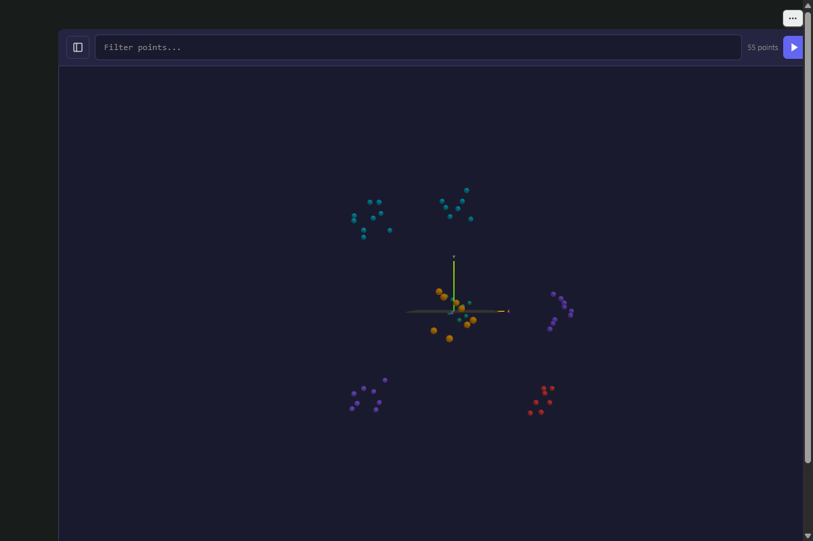

# anywidget-vector

Interactive 3D vector visualization for Python notebooks.

Works with Marimo, Jupyter, VS Code, Colab, anywhere [anywidget](https://anywidget.dev/) runs.



## Features

- **Universal**: One widget, every notebook environment
- **6D Visualization**: X, Y, Z position + Color, Shape, Size encoding
- **Backend-agnostic**: NumPy, pandas, Grafeo, Qdrant, Chroma, Pinecone, Weaviate, LanceDB, or raw dicts
- **Interactive**: Orbit, pan, zoom, click, hover, box select
- **Customizable**: Color scales, shapes, sizes, themes
- **Performant**: Instanced rendering for large point clouds

## Installation

```bash
uv add anywidget-vector
uv add "anywidget-vector[grafeo]"   # with the embedded Grafeo backend (grafeo 0.6)
```

Requires Python 3.12 or later. The `grafeo` extra installs grafeo 0.6 (`grafeo>=0.6.0,<0.7`); the browser-side WASM mode loads the matching `@grafeo-db/wasm` from a CDN. Upgrading from 0.3 with Grafeo:
see [Upgrading to 0.4](#upgrading-to-04).

## Quick Start

```python
from anywidget_vector import VectorSpace

widget = VectorSpace(points=[
    {"id": "a", "x": 0.5, "y": 0.3, "z": 0.8, "label": "Point A", "cluster": 0},
    {"id": "b", "x": -0.2, "y": 0.7, "z": 0.1, "label": "Point B", "cluster": 1},
    {"id": "c", "x": 0.1, "y": -0.4, "z": 0.6, "label": "Point C", "cluster": 0},
])

widget
```

## Data Sources

### Dictionary

```python
widget = VectorSpace.from_dict({
    "points": [
        {"id": "a", "x": 0, "y": 0, "z": 0},
        {"id": "b", "x": 1, "y": 1, "z": 1},
    ]
})
```

### NumPy Arrays

```python
import numpy as np

positions = np.random.randn(100, 3)
widget = VectorSpace.from_numpy(positions)
```

### pandas DataFrame

```python
import pandas as pd

df = pd.DataFrame({
    "x": [0.1, 0.5, 0.9],
    "y": [0.2, 0.6, 0.3],
    "z": [0.3, 0.1, 0.7],
    "cluster": ["A", "B", "A"],
    "size": [0.5, 1.0, 0.8],
})

widget = VectorSpace.from_dataframe(
    df,
    color_col="cluster",
    size_col="size",
)
```

### UMAP / t-SNE / PCA

```python
import umap

embedding = umap.UMAP(n_components=3).fit_transform(high_dim_data)
widget = VectorSpace.from_umap(embedding, labels=labels)
```

### Qdrant

```python
from qdrant_client import QdrantClient

client = QdrantClient("localhost", port=6333)
widget = VectorSpace.from_qdrant(client, "my_collection", limit=5000)
```

### ChromaDB

```python
import chromadb

client = chromadb.Client()
collection = client.get_collection("embeddings")
widget = VectorSpace.from_chroma(collection)
```

### Pinecone

```python
from pinecone import Pinecone

pc = Pinecone(api_key="...")
index = pc.Index("my-index")
widget = VectorSpace.from_pinecone(index, limit=5000)
```

### Weaviate

```python
import weaviate

client = weaviate.Client("http://localhost:8080")
widget = VectorSpace.from_weaviate(client, "Article", limit=5000)
```

### LanceDB

```python
import lancedb

db = lancedb.connect("~/.lancedb")
table = db.open_table("vectors")
widget = VectorSpace.from_lancedb(table, limit=5000)
```

## Visual Encoding

### 6 Dimensions

| Dimension | Visual Channel | Example |
|-----------|---------------|---------|
| X | Horizontal position | `x` coordinate |
| Y | Vertical position | `y` coordinate |
| Z | Depth position | `z` coordinate |
| Color | Hue/gradient | Cluster, score |
| Shape | Geometry | Category, type |
| Size | Scale | Importance, count |

### Color Scales

```python
widget = VectorSpace(
    points=data,
    color_field="score",           # Field to map
    color_scale="viridis",         # Scale: viridis, plasma, inferno, magma, cividis, turbo
    color_domain=[0, 100],         # Optional: explicit range
)
```

### Shapes

```python
widget = VectorSpace(
    points=data,
    shape_field="category",
    shape_map={
        "type_a": "sphere",        # Available: sphere, cube, cone,
        "type_b": "cube",          #            tetrahedron, octahedron, cylinder
        "type_c": "cone",
    }
)
```

### Size

```python
widget = VectorSpace(
    points=data,
    size_field="importance",
    size_range=[0.02, 0.15],       # Min/max point size
)
```

## Interactivity

### Events

```python
widget = VectorSpace(points=data)

@widget.on_click
def handle_click(point_id, point_data):
    print(f"Clicked: {point_id}")

@widget.on_hover
def handle_hover(point_id, point_data):
    if point_id:
        print(f"Hovering: {point_id}")

@widget.on_selection
def handle_selection(point_ids, points_data):
    print(f"Selected {len(point_ids)} points")
```

### Selection

```python
widget.selected_points              # Current selection
widget.select(["a", "b"])           # Select points
widget.clear_selection()            # Clear
widget.selection_mode = "box"       # Switch to box-select mode
```

### Camera

```python
widget.camera_position              # Get position [x, y, z]
widget.camera_target                # Get target [x, y, z]
widget.reset_camera()               # Reset to default
widget.focus_on(["a", "b"])         # Focus on specific points
```

## Distance Metrics

Compute distances and visualize similarity relationships between points.

### Supported Metrics

| Metric | Description |
|--------|-------------|
| `euclidean` | Straight-line distance (L2 norm) |
| `cosine` | Angle-based distance (1 - cosine similarity) |
| `manhattan` | Sum of absolute differences (L1 norm) |
| `dot_product` | Negative dot product (higher = closer) |

### Color by Distance

```python
widget.color_by_distance("point_a")
widget.color_by_distance("point_a", metric="cosine")
```

### Find Neighbors

```python
neighbors = widget.find_neighbors("point_a", k=5)
# Returns: [("point_b", 0.1), ("point_c", 0.2), ...]

neighbors = widget.find_neighbors("point_a", threshold=0.5)
```

### Show Connections

```python
widget.show_neighbors("point_a", k=5)
widget.show_neighbors("point_a", threshold=0.3)

# Manual connection settings
widget = VectorSpace(
    points=data,
    show_connections=True,
    k_neighbors=3,
    distance_metric="cosine",
    connection_color="#00ff00",
    connection_opacity=0.5,
)
```

### Compute Distances

```python
distances = widget.compute_distances("point_a")
# Returns: {"point_b": 0.1, "point_c": 0.5, ...}

# Use high-dimensional vectors (not just x,y,z)
distances = widget.compute_distances(
    "point_a",
    metric="cosine",
    vector_field="embedding"
)
```

## Options

```python
widget = VectorSpace(
    points=data,
    width=1000,
    height=700,
    background="#1a1a2e",         # Dark theme default
    show_axes=True,
    show_grid=True,
    axis_labels={"x": "PC1", "y": "PC2", "z": "PC3"},
    show_tooltip=True,
    tooltip_fields=["label", "x", "y", "z", "cluster"],
    selection_mode="click",       # "click", "multi", or "box"
    use_instancing=True,          # Performance: instanced rendering
)
```

## Backends

Configure a backend for interactive querying:

```python
widget.set_backend("chroma", client=collection)
widget.set_backend("lancedb", client=table)
widget.set_backend("grafeo", client=db)
```

Type a query in the toolbar and press Run (or Enter). An empty result clears the scene; errors show in
the settings panel.

### Grafeo

[Grafeo](https://grafeo.dev/) is the default backend. It runs in three modes, set with
`grafeo_connection_mode`:

| Mode | Where queries run | Setup |
|------|-------------------|-------|
| `embedded` (default) | In Python, on a `grafeo.GrafeoDB` | `uv add "anywidget-vector[grafeo]"` and `set_backend("grafeo", client=db)` |
| `server` | Over HTTP, `POST /query` on [grafeo-server](https://github.com/GrafeoDB/grafeo-server) | `grafeo_server_url="http://localhost:7474"`; start the server with `--cors-origins` so the notebook's origin may call it |
| `wasm` | In the browser, in-memory | Nothing to install: `@grafeo-db/wasm` 0.6.0 loads from the jsDelivr CDN on the first query |

```python
import grafeo
from anywidget_vector import VectorSpace

db = grafeo.GrafeoDB()
db.create_node(["Doc"], {"title": "Graphs", "embedding": [0.9, 0.1, 0.0]})
db.create_node(["Doc"], {"title": "Vectors", "embedding": [0.1, 0.9, 0.2]})
db.create_vector_index("Doc", "embedding", metric="cosine")

widget = VectorSpace(color_field="distance")
widget.set_backend("grafeo", client=db)
widget
```

A k-nearest-neighbor query for the toolbar (GQL, one statement per query):

```
CALL grafeo.search.vector('Doc', 'embedding', [1.0, 0.0, 0.0], 10) YIELD node_id, distance
NEXT MATCH (n:Doc) WHERE id(n) = node_id RETURN n, distance ORDER BY distance
```

How results become points, the same in every mode:

- A node (`RETURN n`) contributes its properties, its labels (`labels`) and its id (`id`).
- An unaliased column is named after its expression (`n.embedding`), and the widget reads it as `embedding`.
- The first of `vector`, `embedding` or `embeddings` becomes the point's `vector`; its first three components
  are the coordinates unless the row also has `x`, `y` and `z`.
- A GQL number with a point (`0.5`) is an exact decimal in Grafeo 0.6; the widget turns it into a float, also inside
  lists and maps, so `RETURN 0.5 AS score` colors and sizes points like any other number.

In `wasm` mode the database starts empty, so load data with one `INSERT` per query and create the index with
`CREATE VECTOR INDEX doc_embedding ON :Doc(embedding) DIMENSION 3 METRIC 'cosine'`. Store embeddings
as `vector([...])` there: a plain list is not indexed. An `INSERT` returns no rows, so it clears the scene; run a
`MATCH` or a search afterwards to see the data.

A query vector with another number of dimensions than the index, or with NaN, is a query error that names the
sizes (for example "the query vector has 2 dimensions; the index on :Doc(embedding) expects 3"); the points stay
as they were.

The distance metrics of a Grafeo vector index (`cosine`, `euclidean`, `dot_product`, `manhattan`) give the
same values as the widget's `distance_metric` and `compute_distances()`.

The browser engine version is set in one place, `GRAFEO_WASM_VERSION` in
`src/anywidget_vector/backends/grafeo/embed.js`, and moves in lockstep with the `grafeo` extra. Before a bump,
run `node tests/js/wasm_smoke.mjs <unpacked @grafeo-db/wasm package>`.

### Upgrading to 0.4

0.4 moves the Grafeo backend to Grafeo 0.6, which changes some query results. What to check:

- **Install**: the `grafeo` extra needs grafeo 0.6; `uv add "anywidget-vector[grafeo]"` upgrades it. The `wasm` mode
  loads `@grafeo-db/wasm` 0.6 from the CDN by itself.
- **Database files**: Grafeo 0.6 keeps every database in a single file. The first read-write open of a 0.5.x
  database migrates it and keeps the old file as `<file>.pre-0.6`; 0.5.x cannot open the migrated file, so stop
  every 0.5.x process first and keep the `.pre-0.6` copy until you no longer need to go back. Opening a directory that
  is not a 0.5.x database fails: pass a file path, such as `data/vectors.grafeo`.
- **Numbers with a point**: `0.1` is an exact decimal in GQL, so `0.0/0.0` and `1/0` now fail the query (division by
  zero) instead of giving NaN or null, and integer overflow fails too. Write float literals with an exponent
  (`0.0e0 / 0.0e0`) where you want IEEE results.
- **Writes**: a `WHERE` right after `INSERT`, `CREATE`, `MERGE` or `DELETE` is an error; put the condition before the
  write. An `INSERT` alone returns no rows.
- **Ordering**: GQL `ORDER BY` puts nulls last in both directions; add `NULLS FIRST` for the old descending order.
- **Errors**: a vector search with a query of the wrong size raises `grafeo.GrafeoError` (Grafeo 0.5.44 panicked);
  the widget shows it as a query error either way.

See Grafeo's [Upgrading to 0.6](https://grafeo.dev/upgrading/0.6/) for the full list.

## Export

```python
widget.to_json()                            # Points as JSON string
widget.to_html()                            # Self-contained HTML string
widget.to_html(title="My Vectors")          # Custom title
widget.save_html("vectors.html")            # Write HTML to file
```

NaN and infinity cannot travel as JSON, so the widget replaces them with `None` in point values (with a
`RuntimeWarning`); a missing coordinate is drawn at 0.

## Environment Support

| Environment | Supported |
|-------------|-----------|
| Marimo | Yes |
| JupyterLab | Yes |
| Jupyter Notebook | Yes |
| VS Code | Yes |
| Google Colab | Yes |
| Databricks | Yes |

## Related

- [anywidget](https://anywidget.dev/), custom Jupyter widgets made easy
- [anywidget-graph](https://github.com/GrafeoDB/anywidget-graph), graph visualization widget
- [Three.js](https://threejs.org/), 3D JavaScript library

## License

Apache-2.0
